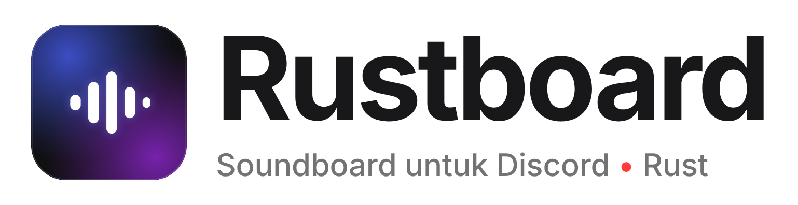

<!-- markdownlint-disable MD033 MD041 -->

> [!NOTE]
> Rustboard adalah proyek pribadi dan tidak berafiliasi dengan Discord maupun VB-Audio.
> Satu-satunya sumber resmi adalah repo ini. Salinan di tempat lain tidak kami jamin.

<p align="center">
  <picture>
    <source media="(prefers-color-scheme: dark)" srcset="assets/Rustboard-full-dark.png">
    <source media="(prefers-color-scheme: light)" srcset="assets/Rustboard-full-light.png">
    
  </picture>
</p>

<p align="center">
  <b>Soundboard dengan hotkey global untuk Discord, ditulis dengan Rust.</b><br>
  Satu file setup. Tanpa .NET, tanpa admin.
</p>

<p align="center">
  <a href="https://github.com/same-09/RustBoard/releases/latest"></a>
  <a href="https://github.com/same-09/RustBoard/stargazers"></a>
  
  
  
  
</p>

<p align="center">
  <a href="https://github.com/same-09/RustBoard/releases/latest">
    
  </a>
</p>

---

> [!WARNING]
> **Status: masih berkembang.** Sebagian kode Rust ditulis tanpa compiler di tangan, lalu diperbaiki lewat build
> GitHub Actions. Error kecil mungkin muncul, dan laporannya sangat membantu.

## Isi

- [Fitur](#fitur)
- [Pasang](#pasang)
- [Go Live: suara dan mic ke Discord](#go-live-suara-dan-mic-ke-discord)
- [Efek suara](#efek-suara)
- [Noise gate dan meter](#noise-gate-dan-meter)
- [Live mix](#live-mix)
- [Remote HP dan aplikasi Android](#remote-hp-dan-aplikasi-android)
- [Shortcut](#shortcut)
- [Tampilan dan warna](#tampilan-dan-warna)
- [Build dari source](#build-dari-source)
- [Lokasi data](#lokasi-data)

## Fitur

**Soundboard**
- Hotkey global: tombol bekerja walau jendela Rustboard tidak di depan, misalnya saat kamu main game.
- Sound tersusun dalam **preset** (kumpulan sound). Ganti preset, daftar sound ikut ganti.
- Tiap sound punya nama, satu atau banyak file (satu dipilih acak tiap diputar), volume, loop, **gambar**, dan **efek** sendiri.
- Kotak sound berjajar ke kanan seperti rak album, dengan gambar di atas dan nama di bawah.
- Sound disalin ke folder `Documents\RustBoard\Soundboard\`, jadi tetap jalan walau file asli dipindah atau dihapus. Ada **Import folder** untuk memasukkan banyak file sekaligus.
- Format: mp3, wav, ogg, flac, m4a/aac, aiff.

**Suara dan Discord**
- **Go Live**: satu tombol mengirim sound dan mic ke Discord lewat kabel virtual (VB-CABLE).
- Dua output: headphone dan Discord, jadi kamu ikut mendengar sound-nya.
- Mic passthrough dengan noise gate dan meter level.
- Live mix: ducking (sound mengecil saat kamu bicara) dan limiter (puncak keras tidak pecah).

**Efek suara**
- Pengubah suara untuk mic: 11 efek (Deep, Chipmunk, Demon, Giant, Robot, Alien, Radio, Megaphone, Cave, 8-bit).
- Efek juga bisa dipasang per sound.

**Remote**
- Remote HP seperti Stream Deck lewat Wi-Fi, dan **aplikasi Android (APK)** mode landscape.

**Aplikasi**
- Setup sendiri dengan tampilan Rustboard, update dari dalam app, tema terang dan gelap mengikuti Windows.

**Beda dengan Rustboard C# yang lama**

| | Rustboard lama | Rustboard |
|---|---|---|
| Bahasa | C# (WPF) | Rust ([Tauri 2](https://tauri.app)) |
| Antarmuka | WPF | HTML, CSS, JS (tanpa framework, tanpa build step) |
| Efek suara mic dan per sound | tidak ada | ada |
| Gambar per sound | tidak ada | ada |
| Remote HP dan APK Android | tidak ada | ada |
| Noise gate, meter, ducking, limiter | tidak ada | ada |
| Update dari dalam app | tidak ada | ada (SHA-256 dicek) |
| Minimize ke tray, ukuran jendela diingat, jendela About | ada | belum |

## Pasang

1. Unduh `Rustboard_x.y.z_x64-setup.exe` dari [Releases](https://github.com/same-09/RustBoard/releases/latest).
2. Klik dua kali. Setup membuat shortcut di Start menu dan desktop. Autostart bisa dipilih.
3. Buka Rustboard, tambah sound, atur hotkey.

Windows 10 atau lebih baru. Per user saja, tidak ada prompt admin. Pemasangan masuk ke `%LOCALAPPDATA%\Rustboard` (atau folder pilihanmu) dan muncul di Apps & features.

**Hapus Rustboard:** Pengaturan Windows > Apps > Rustboard > Uninstall, atau jalankan `uninstall.exe` di folder pemasangan.

**Pindah dari Rustboard lama:**

```
python tools/convert_config.py
```

Membaca `C:\ProgramData\Rustboard\config.xml` lalu menulis `config.json` yang baru. Tombol tanpa padanan (tombol mouse, F13+, tombol media) dilewati dengan peringatan.

## Go Live: suara dan mic ke Discord

1. Pasang [VB-CABLE](https://vb-audio.com/Cable/) (gratis), lalu restart Windows.
2. Di Rustboard tekan **Go Live** (bar atas). Sound dan mic kamu masuk ke `CABLE Input`. Headphone kamu tetap memutar sound seperti biasa.
3. Di Discord: Settings > Voice & Video > Input Device = `CABLE Output`, Noise Suppression dimatikan.
4. Tekan Go Live lagi untuk berhenti. Pengaturan output dan mic manualmu kembali seperti semula.

Settings > **Discord** menunjukkan apakah kabel ketemu dan membiarkan kamu memilih perangkat lain untuk Go Live (bawaan: `Auto`, yang mendahulukan VB-CABLE lalu kabel virtual lain).

## Efek suara

Tab **Sound Effects** (kolom kiri) mengubah suara mic secara langsung. Efek berjalan setelah noise gate dan sebelum volume mic, jadi cocok dengan Go Live dan dengan pasangan Mic input + Mic output.

| Efek | Suara |
|---|---|
| Deep | Suara lebih rendah dan besar |
| Chipmunk | Cepat dan cempreng |
| Demon | Sangat rendah, kasar, gelap |
| Giant | Suara raksasa di aula besar |
| Robot | Robot logam |
| Alien | Alien sci-fi yang bergetar |
| Radio | Walkie-talkie, radio tua |
| Megaphone | Megafon keras dan sengau |
| Cave | Gema gua |
| 8-bit | Renyah seperti konsol retro |

- Pilih satu kartu efek untuk menyalakannya. Matikan lewat saklar **Sound effects** di atas, atau pilih **Clean**. Tiap kartu punya baris hotkey sendiri.
- Efek pitch menambah jeda sekitar 20 sampai 30 ms.
- **Efek per sound:** edit sebuah sound > **Sound effect**. Gema dan reverb tetap bunyi sebentar setelah file selesai. Efek sound tidak bergantung pada efek mic.
- Efek ada di `src-tauri/src/fx.rs` dan punya tes sendiri.

## AI Voice (suaramu jadi suara orang lain)

Di tab **Sound Effects**, bagian paling atas. Ini mengubah suaramu menjadi suara lain secara real-time, dengan model suara (RVC) yang kamu impor.

- **Butuh GPU kuat.** Rustboard mengecek kartu grafismu: NVIDIA dengan VRAM 6 GB atau lebih dianggap kuat. Kalau begitu, saklar langsung bisa dinyalakan.
- **GPU lemah atau tidak ada.** Saat kamu menyalakan, muncul peringatan: suara bisa patah-patah, FPS game turun, PC panas. Kamu tetap boleh menyalakan lewat tombol **Turn on anyway**.
- **Impor suara dari [voice-models.com](https://voice-models.com/).** Tombol `voice-models.com` membuka situsnya di browser. Unduh model (biasanya `.zip` berisi `.pth` dan `.index`), lalu tekan **Import voice** dan pilih file itu. File `.pth` atau `.onnx` langsung juga bisa.
- Suara disalin ke `Documents/RustBoard/Voices/`, satu folder per suara. **Remove** menghapus salinan itu saja, bukan file unduhanmu.
- Pakai suara yang kamu punya hak untuk dipakai. Jangan berpura-pura jadi orang sungguhan tanpa izin mereka.

**Test voice.** Di bagian AI Voice ada baris **Test voice**. Pilih satu suara dengan **Use**, tekan tombolnya, lalu bicara 4 detik ke mic yang kamu pilih di Settings. Setelah itu kamu bisa putar **My voice** (rekamanmu, untuk cek mic) dan **New voice** (hasil suara baru). Rustboard juga mengukur waktu konversi: kalau 4 detik suara selesai diubah jauh di bawah 4 detik, PC-mu cukup cepat untuk live (**Fast**), mendekati 4 detik berarti **Tight**, lebih lama berarti **Too slow**. Klip diputar lewat Primary output seperti sound biasa, jadi tombol ini mati saat **Go Live** menyala supaya tesmu tidak masuk Discord. Kalau mesin bermasalah, alasannya ditulis di layar dan hanya **My voice** yang bisa diputar. Pemuatan pertama lambat (PyTorch dan model dimuat); tes berikutnya lebih cepat. Kode: `src-tauri/src/voice_test.rs`.

**Mesin suara.** Mesinnya adalah RVC. Sebagian kodenya (MIT, dari versi lama RustBoard) ikut tersalin di dalam Rustboard (`src-tauri/engine/rustboard/`, lisensi di `LICENSE-ENGINE`), jadi kamu **tidak perlu** memasang mesinnya sendiri:

1. Di Rustboard, bagian AI Voice, tekan **Install AI voice**. Rustboard memasang semuanya sendiri di `Documents/RustBoard/AI/`: Python 3.12 miliknya sendiri (tanpa installer dan tanpa hak admin), PyTorch, paket AI, dan model dasar. Ada bar kemajuan dan tombol **Cancel**; kalau dibatalkan atau terputus, tekan lagi dan dia lanjut dari tempat berhenti. Unduhan sekitar 3,5 GB dengan kartu NVIDIA (PyTorch CUDA) atau sekitar 0,8 GB tanpa NVIDIA (PyTorch CPU), 5 sampai 15 menit.
2. Impor suara, tekan **Use**, nyalakan saklar, lalu **Go Live**.

**Remove engine** menghapus folder `AI` (beberapa GB). Suara yang kamu impor ada di `Documents/RustBoard/Voices/` dan tidak ikut terhapus.

Sudah punya folder engine? Tombol **Choose folder** (bagian "Already have an engine folder?") tetap ada: pilih folder yang berisi folder `rustboard`, dan folder itu yang dipakai. **Auto** = engine yang dipasang Rustboard, atau folder `Engine` di `Documents/RustBoard`, atau `RustBoard-Engine` di `Documents`, `Downloads`, `Desktop`, atau `RUSTBOARD_ENGINE_DIR`.

Di Windows, installer memakai Python "embeddable" dari python.org. Di Linux/macOS dia membuat venv dari Python 3.10 sampai 3.13 yang sudah ada di PC.

Saat nyala, mic masuk ke mesin per blok 0,12 detik (mode **Balanced** di GPU, **Laptop** di CPU) dan hasilnya keluar ke mic output. Selama mesin masih memuat (10 detik atau lebih, pertama kali bisa lebih lama) atau kalau gagal, mic **dibisukan** supaya suara asli tidak bocor ke Discord; alasannya tampil di layar. Efek mic (Sound Effects) tetap dipasang setelah suara AI. Delay kira-kira 0,2 sampai 0,4 detik.

**Status:** jalan, dengan installer sendiri. Kode: `src-tauri/src/ai_setup.rs` (installer), `src-tauri/src/voice_ai.rs` (cari mesin, jalankan program bantu), `src-tauri/engine/rb_bridge.py`, dan sambungan mic di `src-tauri/src/audio.rs`.

## Noise gate dan meter

Settings > **Noise gate & meters** (dua saklar terpisah):

- **Noise gate** (mati bawaan): membisukan mic di sela kata, supaya suara keyboard dan kipas tidak masuk Discord. Slider **threshold** (-70 sampai -20 dB, bawaan -50) adalah level yang harus dilewati suaramu agar gate terbuka. Gate terbuka dalam 5 ms, tetap terbuka 200 ms setelah kamu berhenti (ujung kata tidak terpotong), lalu menutup halus dalam 80 ms.
- **Level meters** (nyala bawaan): **IN** adalah mic sebelum gate, **OUT** adalah yang keluar ke kabel atau output mic (setelah gate dan volume mic). Garis merah di IN menandai threshold. Atur gate sambil melihat IN: taruh threshold di antara suara ruangan dan suaramu. Meter hanya jalan saat Settings terbuka.
- Keduanya butuh mic yang menyala: Mic input dan Mic output di Settings, atau **Go Live**.

## Live mix

Settings > **Live mix**:

- **Ducking:** sound mengecil saat kamu bicara, jadi temanmu mendengar suaramu. Jalan di output yang membawa mic (Go Live). Butuh mic menyala. Mati bawaan.
- **Limiter:** mencegah puncak keras pecah di Discord. Berlaku untuk sound dan mic. Nyala bawaan.

## Remote HP dan aplikasi Android

Settings > **Phone remote** (mati bawaan) menjalankan server kecil di Wi-Fi kamu. Remote dipakai lewat **aplikasi Android Rustboard Remote** (APK di bawah), bukan lewat web. Dari HP, ketuk sound untuk memutarnya, pilih efek mic, ganti preset, atur volume, dan Pause, Continue, atau Stop semua.

1. PC: Rustboard > Settings > Phone remote > nyalakan. QR code muncul di sana.
2. HP dan PC harus memakai Wi-Fi yang sama. Kalau Windows bertanya soal jaringan, izinkan **Private networks**.
3. Port bawaan `8787`. Ganti kalau dipakai aplikasi lain.

Link ini hanya untuk aplikasi Android. Kalau dibuka di browser, yang muncul cuma pesan singkat, tidak ada halaman kontrol lagi. Link berisi token rahasia, jadi siapa pun yang punya link bisa memakai remote. **New link** membuat token baru dan link lama berhenti bekerja. Server memakai HTTP biasa, hanya untuk jaringan lokal: jangan buka port di router.

<details>
<summary><b>Aplikasi Android (APK)</b></summary>

Folder `android/` berisi aplikasi Android kecil: remote HP sebagai aplikasi sungguhan, bukan tab browser.

- Hanya mode landscape, layar tetap menyala.
- Tampilan menyesuaikan ukuran layar sendiri. Tombol **A−** dan **A+** di kiri menyetel lebih halus, dan pilihannya tersimpan.
- HP bergetar saat tombol ditekan.

Cara pakai:

1. PC: Settings > Phone remote > nyalakan. QR code muncul di sana.
2. HP: buka aplikasi, tekan **Scan QR**, arahkan kamera ke QR code di PC. Langsung tersambung. Izinkan kamera saat diminta.
3. Tanpa kamera? Tekan **Copy link** di PC, kirim ke HP (chat atau email), salin, buka aplikasi, tekan **Paste**, lalu **Connect**.

Link diingat. Tombol **PC** kembali ke layar sambung.

Kalau aplikasi crash, layar merah berisi error muncul saat dibuka lagi (ada tombol Copy), supaya penyebabnya bisa dikirim.

Pemindai QR buatan aplikasi sendiri (library ZXing yang open source, jalan di dalam APK). Tidak memakai Google Code Scanner, Google Play services, atau Google Lens, dan jalan tanpa internet.

APK dibangun oleh GitHub (`.github/workflows/android.yml`). Tag seperti `v0.1.7` menambahkan `Rustboard-Remote_0.1.7.apk` ke Release yang sama dengan setup Windows. Di HP: buka APK dan izinkan "install unknown apps" untuk aplikasi file atau browsermu. Build ditandatangani dengan `android/rustboard-remote.keystore`, kunci publik di repo ini supaya tiap build bisa menimpa versi sebelumnya. Cukup untuk alat pribadi, tidak untuk Play Store.

Halaman aplikasi bisa dibuka di browser PC tanpa HP: `android/app/src/main/assets/index.html`.

</details>

## Shortcut

Atur di Settings dan di dialog tiap sound. Tekan kombinasi tombol yang kamu mau. Begitu tombol dilepas, semua tombol yang tadi ditahan menjadi kombinasinya.

- **Sound:** tiap sound punya kombinasi sendiri, hanya aktif untuk preset yang sedang dipilih.
- **Preset:** tiap preset punya tombol ganti. Menggandakan preset mengosongkan tombolnya (dua preset di satu tombol saling berebut).
- **Efek mic:** tekan satu kali menyalakan efek, tekan efek yang sama lagi mematikan semua efek.
- **Pause all, Continue, Stop all:** tiga tombol kontrol untuk semua sound.

Nama tombol memakai nama `rdev` (`KeyA`, `Kp1`, `F5`, dan seterusnya), bukan VKey Windows. Di Linux hook tombol butuh X11 (tanpa Wayland). Di macOS izinkan Accessibility.

## Tampilan dan warna

Antarmuka Rustboard hitam dan putih yang bersih dengan satu aksen merah. Aksen merah dipakai untuk hal yang sedang "hidup" (Go Live, garis threshold, peringatan). Tema mengikuti Windows: terang atau gelap.

| | Terang | Gelap |
|---|---|---|
| Latar |  `#f5f5f7` |  `#0a0a0a` |
| Panel |  `#dedee3` |  `#1a1a1a` |
| Teks |  `#18181b` |  `#ffffff` |
| Tombol utama |  `#18181b` |  `#d9d9dd` |
| Aksen |  `#ff3b3b` |  `#ff4d4d` |
| OK |  `#16a34a` |  `#4ade80` |

Sudut membulat: 8 px (kontrol), 12 px (item), 20 px (panel). Font: SF Pro, Segoe UI Variable, lalu Inter dan font sistem. Kotak sound tanpa gambar mendapat cover warna otomatis dari namanya, dengan ikon bar suara putih di tengah. Ikon dan logo ada di `assets/`.

## Build dari source

Butuh Rust dan [prasyarat Tauri](https://tauri.app/start/prerequisites/).

```
cargo install tauri-cli --version "^2"
cd src-tauri
cargo tauri dev        # jalankan
cargo tauri build      # installer
```

Workflow `.github/workflows/build.yml` membangun `Rustboard_x.y.z_x64-setup.exe`. Tag `v*` melampirkannya ke GitHub Release, dan tag yang sama juga membangun APK Android. Push ke `main` hanya menguji build.

**Update dalam app:** saat mulai, app bertanya ke GitHub soal Release terbaru. Kalau lebih baru, sebuah bar menulis "New version ... is available" dengan tombol **Update**. App mengunduh setup dari Release kita sendiri (SHA-256 dicek kalau GitHub memberikannya), menjalankannya, lalu keluar. Tidak ada tanda tangan, jadi kepercayaan hanya dari HTTPS dan repo GitHub kita.

**Setup sendiri.** File setup bukan NSIS. Itu aplikasi Tauri kecil di `setup/` yang menampilkan `installer-ui/` (pasang) dan `uninstaller-ui/` (hapus) dengan gaya Rustboard. Ia menyalin diri ke `<folder pemasangan>\uninstall.exe`. Update dalam app memanggilnya dengan `/P /R` (tanpa jendela, pasang di atas versi lama, lalu buka Rustboard lagi).

```
cargo install tauri-cli --version "^2" --locked
pwsh tools/build_setup.ps1        # -> dist-setup/Rustboard_<versi>_x64-setup.exe
```

**Kerja di UI tanpa Rust:**

```
python tools/dev_server.py
# buka http://127.0.0.1:8765
```

Backend palsu: tanpa suara dan tanpa hotkey global (tombol dibaca dari halaman).

<details>
<summary><b>Peta kode</b></summary>

```
src-tauri/src/
  main.rs      perintah Tauri dan setup
  config.rs    model config, baca/simpan (config.json)
  audio.rs     thread audio: 2 output, mixer, mic passthrough (resampler, noise gate, meter), Go Live, deteksi VB-CABLE
  fx.rs        efek suara (pengubah suara): pitch, echo, reverb, robot, ...
  images.rs    gambar sound: file -> data URL untuk UI
  library.rs   folder Soundboard dan Import folder
  remote.rs    server remote HP (untuk aplikasi Android), QR code
  hotkeys.rs   hook tombol global (rdev)
  logic.rs     pencocokan shortcut, ganti preset
  state.rs     state app bersama
  updater.rs   cek Release GitHub, unduh setup, SHA-256
  links.rs     link web yang boleh dibuka dari UI
ui/            index.html, style.css, js/{main,api,keys}.js
setup/         setup sendiri (Tauri), UI di installer-ui/ dan uninstaller-ui/
android/       aplikasi remote Android (WebView + halaman di assets/)
tools/         convert_config.py, dev_server.py, build_setup.ps1
```

</details>

## Lokasi data

| Apa | Di mana |
|---|---|
| Config | `<app data>/com.rustboard.app/config.json` |
| Salinan sound | `Documents\RustBoard\Soundboard\` |
| Pemasangan | `%LOCALAPPDATA%\Rustboard` |

`<app data>` adalah `%APPDATA%` di Windows, `~/.local/share` di Linux, dan `~/Library/Application Support` di macOS.

## Belum ada

- AI Voice tanpa Python dan PyTorch (mesin murni Rust, mis. lewat ONNX). Sekarang Rustboard memasang Python + PyTorch sendiri, lihat bagian AI Voice.
Minimize ke tray, ingatan ukuran jendela, jendela About, dan format wma.

Mic passthrough butuh perangkat audio 32-bit float. Mic dan output boleh punya sample rate berbeda (resampler linear sederhana dengan buffer jitter 40 ms).

## Terima kasih

Rustboard adalah port dari aplikasi Rustboard C# / WPF yang lama ke Rust. [VB-CABLE](https://vb-audio.com/Cable/) dari VB-Audio dipakai untuk mengirim suara ke Discord.

## Lisensi dan kredit

Rustboard memakai [lisensi MIT + kredit wajib](LICENSE). Hak cipta © 2026 [same-09](https://github.com/same-09).

**Kredit wajib.** Kalau kamu memakai, mengubah, mem-fork, atau membagikan proyek ini, kamu harus menampilkan kredit ini dengan jelas:

> Based on Rustboard by same-09 - <https://github.com/same-09/RustBoard>

- Taruh di README atau dokumentasi hasil karyamu.
- Kalau hasil karyamu dibagikan ke orang lain, taruh juga di dalam aplikasinya (misalnya di Settings atau About) dan di halaman unduhnya.
- Dilarang menghapus, menyembunyikan, atau mengganti kredit, dan dilarang mengaku ini karyamu sendiri.
- Dipakai pribadi tanpa dibagikan tidak perlu kredit.

Sertakan juga file `LICENSE`. Repo asli: <https://github.com/same-09/RustBoard>.
